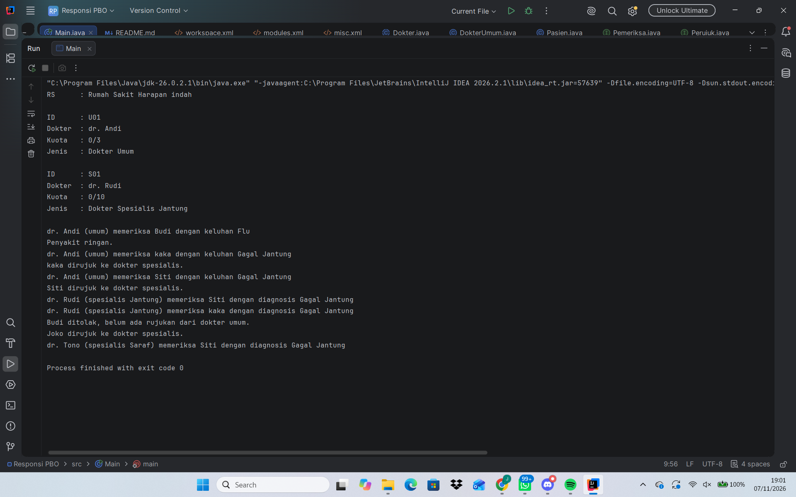

Nama    : Java Alfanza Setiawan
NIM     : H1D025006
Shift Awal : D
Shift Akhir : F

A.Sistem Manajemen Dokter dan Pasien rumah sakit
Program ini adalah simulasi sistem pelayanan pasien di Rumah Sakit Harapan Indah
yang dibuat dengan bahasa Java menggunakan konsep Pemrograman Berorientasi Objek (PBO).
Sistem berfokus pada alur pemeriksaan pasien oleh dokter umum dan rujukan ke dokter spesialis. Apabila pasien diriwayatkan penyakit ringan maka bisa dimasukan ke dokter umum
apabila diriwayatkan penyakit berat maka pasien yang awalnya diperiksa oleh dokter umum, akan dirujuk ke dokter spesialis. 
Dan apabila ada pasien yang langsung menuju ke dokter spesialis maka akan ditolak karena belum melakukan rujukan dari dokter umum

B.cara compile atau run 
1. Bisa run di intelij Idea dengan cara
a. Buka file Main.java
b. Pada baris sebelah kiri public static void main (String[ args) terdapat tombol ikon hijau
c. Klik ikon segitiga hijau

C. 

